# phil

A scopemaxed, vibecoded file manager and the engine it
runs on. The UI is plain HTML/CSS/JS, shown in windows of
[salir](https://github.com/navnlaus/salir) (Chromium, through CEF); the
backend is JavaScript running on Deno. No npm dependencies.\
Developed and tested on Omarchy, the install scripts assumes a similar setup.

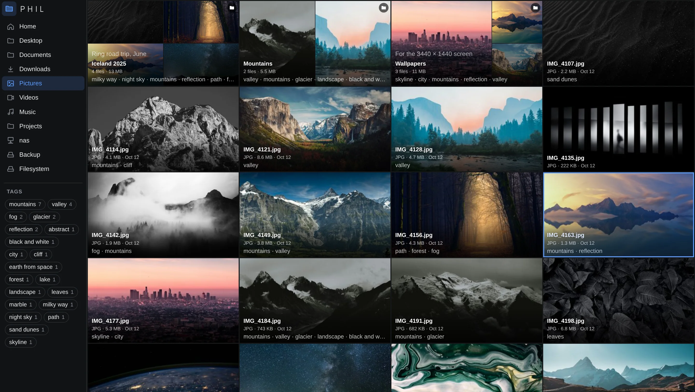

| | |
|---|---|
| 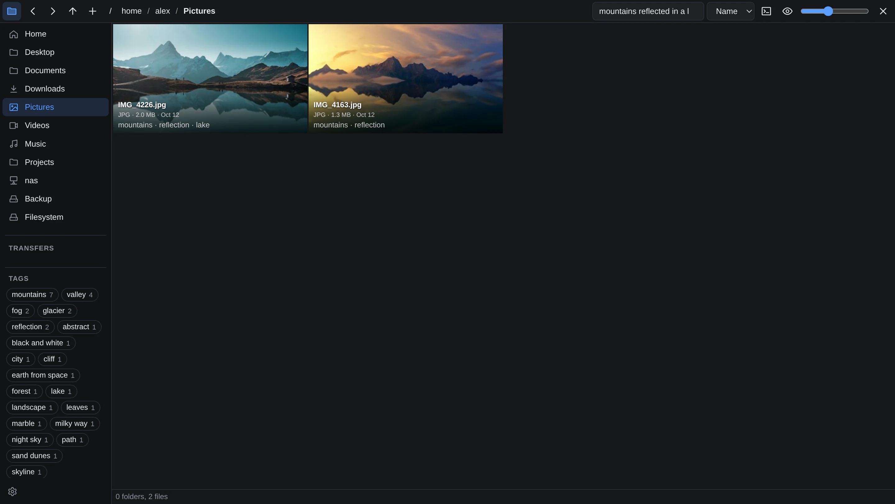 | 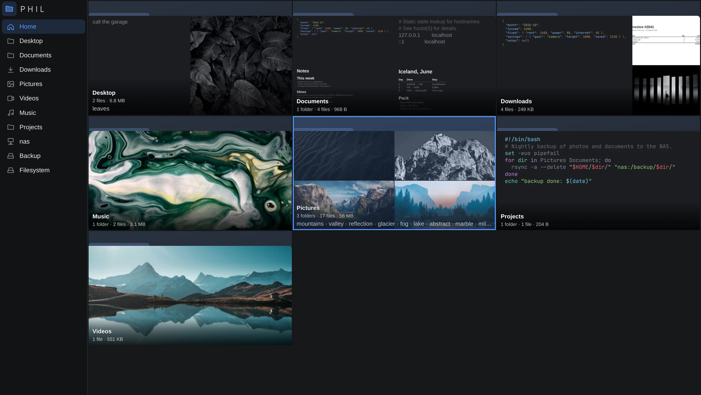 |
| Search by description: "mountains reflected in a lake" (auto-tagging: SigLIP 2, EmbeddingGemma 2 for documents) | Folders preview what's in them, and their most common tags |
| 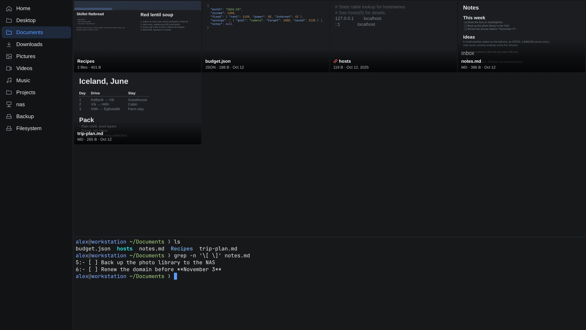 | 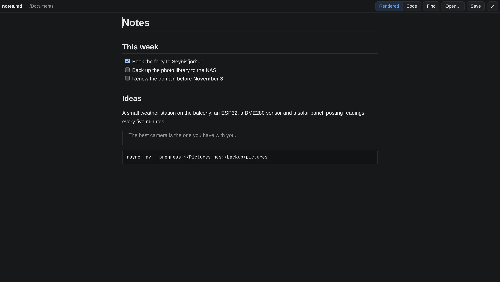 |
| The terminal panel follows the folder you're in, and the other way round | Markdown, edited as it reads (textedit) |
| 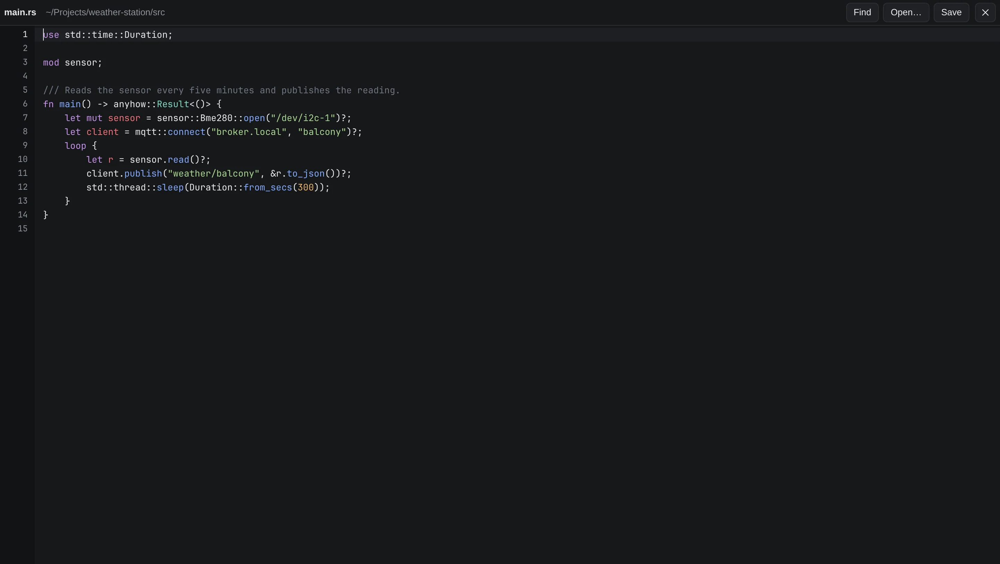 | 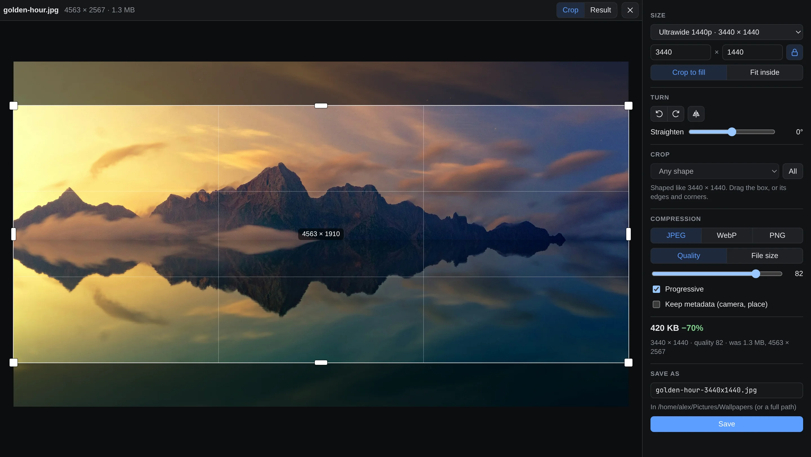 |
| Code, highlighted (textedit) | Resize, crop, turn and compress (imageresize) |
| 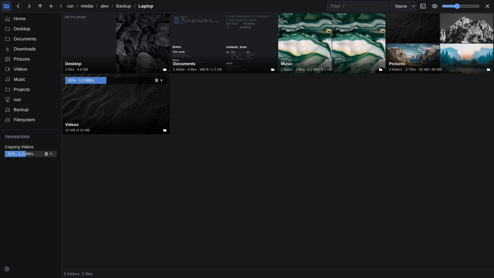 | 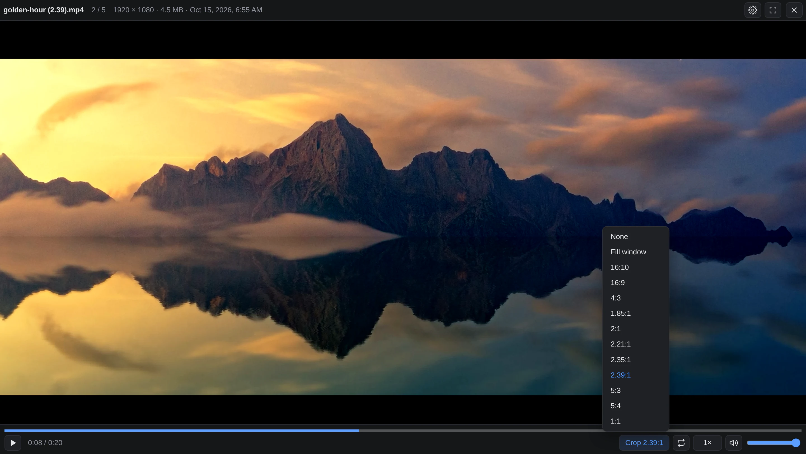 |
| Copying to another drive with rsync: progress on the folder and in the sidebar, pause, stop and resume | Videos play in the window (videoplayer); Crop cuts off the bars in the picture |
| 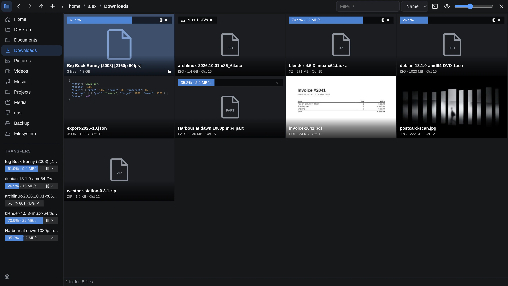 | 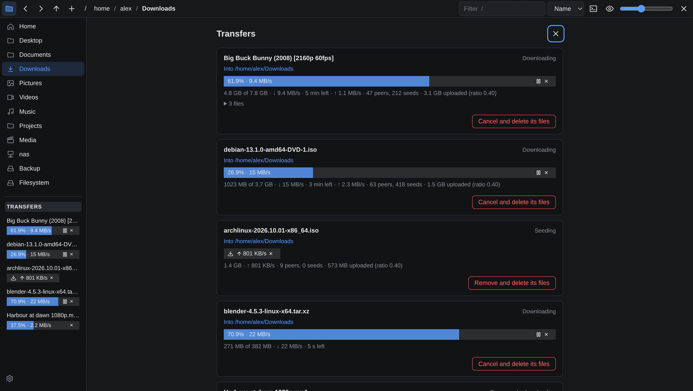 |
| Torrents and web downloads (panda-dl) and browser videos (Streamgrab), as they come in | The Transfers view: each in full, and the settings for downloads |
| 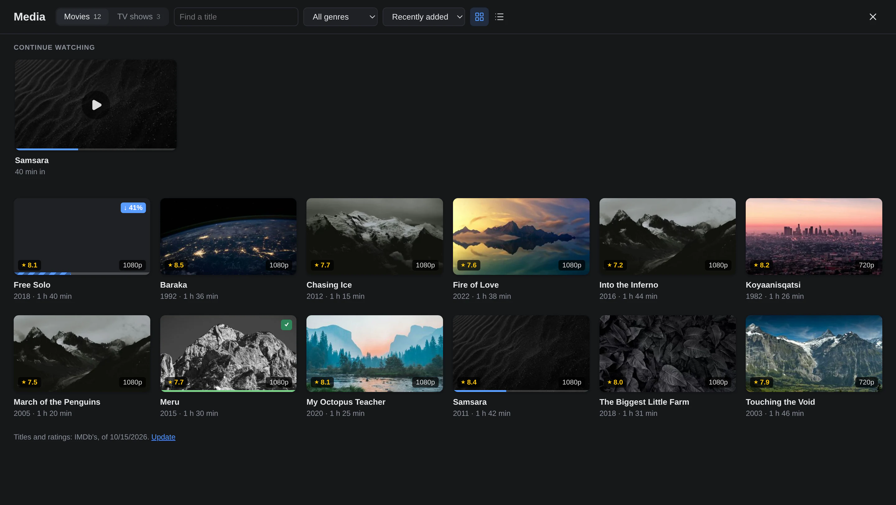 | 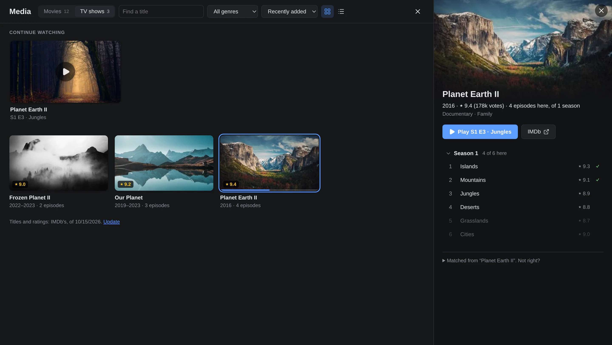 |
| Movies and TV shows from the folders marked as media, matched with IMDb's titles and ratings on this computer (mediaview): what's been started first, downloads as they come in | A show's seasons and episodes: watched, here, or missing; the next one to play |
| 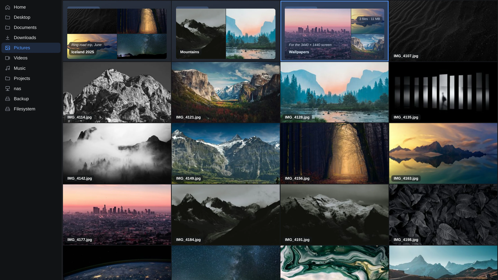 | |
| Themes: here, chips | |

<sub>Photos from [Unsplash](https://unsplash.com). mediaview's library is made up: the titles are real, the pictures are those same photos.</sub>

## The engine and its apps

phil is one app of `phil-engine`, which runs apps in one background process:
their windows (salir's: see [Windows](#windows-salir)) are driven from its main thread, and their servers run in a worker.
The first app you run starts the engine in the background; after that, an app's
command just asks the running engine for a window and returns, so windows open
quickly. The engine keeps running after its last window closes.

- **phil**, the file manager (below).
- **jsonedit**, a JSON editor: `jsonedit file.json` (see [jsonedit](#jsonedit)).
- **textedit**, a text editor with syntax highlighting and Markdown that can be
  edited as it reads: `textedit file` (see [textedit](#textedit)).
- **imageview**, an image viewer: `imageview picture.jpg`, and the other images
  in its folder (see [imageview](#imageview)).
- **videoplayer**, a video player: `videoplayer film.mkv`, and the other videos
  in its folder; what the browser can't play, ffmpeg converts as it plays (see
  [videoplayer](#videoplayer)).
- **imageresize**: resize, crop and compress an image (right-click it in phil;
  see [imageresize](#imageresize)).
- **mediaview**, your movies and TV shows: `mediaview`, the videos in the
  folders marked as media, matched with IMDb's titles and ratings on this
  computer (phil's sidebar: Media; see [mediaview](#mediaview)).
- **camview**, network cameras live: `camview`, every camera that's on, side
  by side; `camview camera`, one, with pan, tilt and zoom (phil's sidebar:
  Cameras; see [camview](#camview)).
- **phil-editor** (`ed` with `alias ed=phil-editor`): the right editor for a
  file, jsonedit for JSON and textedit for other text. Typed in phil's terminal
  panel, it opens the editor in that phil window (the panel's shell has
  `PHIL_TERMINAL` and `PHIL_ENGINE_SOCKET`; the editor's Esc returns to the
  terminal); anywhere else, in a window of its own.

Each app gets its own server on 127.0.0.1, with its own port and origin; its
windows get its own Wayland app id (`phil`, `jsonedit`) for window rules. Apps
share a look: a top (and bottom) bar that floats over the page and fades out
until hovered (phil's top bar stays, with the folder below it), with an X at
the right that closes the window (`themes/base.css`, `engine/ui/kit.js`). One app can show another inside its window:
phil opens `.json` files in jsonedit, other text files and documents in textedit, images
in imageview and videos in videoplayer that way, and the app's X (or Esc) goes back to the folder. Copying and pasting go through
the desktop's clipboard (`wl-copy` / `wl-paste`), so they show up in Omarchy's
clipboard history and take what was copied anywhere; every way of pressing
them works the same: Ctrl+C / Ctrl+V, Super+C / Super+V, Ctrl+Insert /
Shift+Insert (what Omarchy's Super+C / Super+V send to windows tagged as
terminals, like phil's).

- The engine finds the running one through `$XDG_RUNTIME_DIR/phil/main.sock`.
  It keeps no log: its output goes nowhere unless `"log": true` is in
  `~/.config/phil/settings.json` (or it's started with `PHIL_LOG=1`); then
  to `main.log` next to it (an incognito engine's only with `PHIL_LOG=1`,
  deleted when it exits). It applies from the engine's next start (`phil --quit`).
- An app's options can pick a separate engine (a profile): incognito phil
  windows get their own (`incognito.sock`): separate servers, token and a
  throwaway browser profile, app id `phil-incognito` and a purple stripe along the top. It
  exits, deleting its temporary thumbnails, with its last window. "Show in
  folder" always goes to the normal engine. Non-default `--thumb-dir`,
  `--thumb-size`, `--jobs` or `--port` also get an engine of their own, so those
  options always apply.
- Engine options, with any app: `--quit` stops the background engine (`phil
  --incognito --quit` the incognito one); `--retire` (`phil-engine --retire`)
  makes every running engine keep its windows but take no new ones and exit once
  those close (`deno task install` does this); `--standalone` runs the app in a
  process of its own that exits with its window (`deno task start` uses it, so
  development runs don't end up in the installed engine); `--browser` prints a
  URL instead of opening a window.

### phil as the file chooser

`phil --choose open|dir|save [--multiple] --out FILE [path]` is a file chooser:
a phil window with a bar at the bottom saying what's asked ("Choose a file",
"Choose folders", "Save as" with the suggested name, its extension left out of
the selection), and Open or Save, and Cancel. Double-click (or Enter) on a file
chooses it; folders asked for, none selected: the folder shown; to save, a file
clicked gives its name, and replacing one asks first. It waits until the choice
is made (or the window is closed, any way: cancelled), then the chosen paths
are in FILE, one per line (nothing: cancelled). Esc cancels, anywhere in it, unless something over it takes it first (a menu, a dialog, the viewer, renaming, a filter being cleared). This is the wrapper interface
of `xdg-desktop-portal-termfilechooser`, which makes it the desktop's file
chooser: apps' Open and Save dialogs (a browser's, say) are phil windows. Its windows' class is `phil-choose`, for a window rule that floats
them; they don't open the terminal panel or change the folder phil reopens. They start with hidden files hidden and without the sidebar's Transfers and Cameras, and keep their own sort, tile size and sidebar (the settings' `chooser`), apart from phil's windows'.

### Windows: salir

The engine's windows are [salir](https://github.com/navnlaus/salir)'s:
Chromium (CEF), each page in a window of its own that Chromium draws and shows
itself (salir's direct windows), driven through salir's `--control` channel
(JSON lines on its stdin and stdout; `engine/salir.js`). salir is found on
`PATH` (its `make install` puts it in `~/.local/bin`), or `PHIL_SALIR` names it.

- One salir for all the engine's windows, started with the first, with a
  profile of its own (`~/.local/state/phil/salir`; incognito, or while another
  engine's salir still has it: a throwaway one). With no windows for 10
  minutes, a background engine closes it; the next window starts it again.
- A window's address, with its server's session token, goes to salir over
  that pipe, not on a command line others can read. The servers' certificate
  is given to salir to trust, that one alone (HTTP/2, below).
- A window's class (Wayland app id) is the app's: `phil`, `phil-choose`,
  `phil-incognito`, `camview`…, for window rules.
- A left-drag of files takes them out of the window as files: onto a
  browser's page (an upload), a file manager, a chat. A page's `file://` URIs
  are blanked by Chromium as a drag leaves it, so the files go as File objects,
  salir's (`salir.files`: the engine's windows allow it), asked for on the press
  that may start the drag; a drag quicker than that carries the URIs. A right-
  or middle-drag stays in the window. Files dropped in from other programs come
  without their paths (Chromium keeps them from pages).
- Right-clicking something phil has no menu for shows nothing.
- Pages talk to the engine through `window.salir` (`engine/ui/kit.js`): "ready",
  "close", and a window of another app over this one (`openOver`, below).
- Nothing goes to Google behind the pages' backs (salir turns Chrome's
  background services off).
- **Video plays through mpv** (libmpv), under the page: phil's plugin for salir
  (`native/salir-mpv`, a `<salir-embed kind="mpv">` in the page) renders it in
  salir's GL context, decoding on the GPU, and the page is drawn over it. It
  plays what salir's Chromium can't (H.264, AAC and H.265: CEF's official
  builds are made without them, for their licences; VP9, AV1, Opus, MP3 and FLAC
  it does). videoplayer and camview use it; their windows are salir's
  composited ones (an app's `embeds` in its `launch.js`), the others Chromium's
  own. salir is given the plugin with `--plugin`: `PHIL_SALIR_MPV`, else
  `~/.local/lib/phil/salir-mpv.so` (`install.sh` builds it there when libmpv's
  headers are installed), else the one built here (`deno task mpv-plugin`).
  Without it, they play as a browser would (H.264 doesn't: camview shows its
  MJPEG stream).
- **Windows over windows**: a video or the cameras opened from phil (or a video
  from the media view) open in videoplayer's or camview's own window, as mpv
  needs. On Hyprland it goes into the phil window's tile, as a group of the
  two with no tab bar, border or shadow, so it looks as it would inside it;
  Hyprland's keys and layouts move and tile the two as one (another
  workspace, the master area, fullscreen…), and it closes with that window.
  Closed, phil's window is as it was. Taken out of the group (Super+Alt+G on
  Omarchy, Hyprland's "move out of group"), it's let go: it floats, a window
  like any other. (`engine/hyprland.js`: Lua run in Hyprland through `hyprctl
  eval`, which knows the window by its first title, and the one it goes with
  by its process, salir's.) They open and close without Hyprland's
  animations, as they would inside phil. Elsewhere they open where the desktop
  puts them. Esc closes it, back to phil, with the video you were on selected.
  What Hyprland did with them, the last 30 things: `hyprctl eval
  'error(table.concat(phil_attach.log, "\n"), 0)'`.
- A window a page closes (Esc, ×) is off the screen at once; what it held is
  shut down after (an mpv takes up to 0.4 s: a wall of cameras, a second or
  so), one at a time, the other windows answering in between.
- Composited windows (videoplayer's, camview's) have no clipboard of their
  own: pasting into their text fields doesn't work there.

## Install

```sh
deno task install
```

Builds `phil-engine` and installs it to `~/.local/bin`, with a small `phil` and
`jsonedit` command next to it, and makes phil the default file manager. Rerun it
after changing the code. The windows are salir's: install it first (`make
install` in its checkout, [github.com/navnlaus/salir](https://github.com/navnlaus/salir)).
A running phil keeps its windows but takes no new ones: the next window is the
new build.

- phil's mpv plugin for salir (`native/salir-mpv`), built and put in
  `~/.local/lib/phil` when libmpv's headers are there (`pkg-config mpv`), for
  videoplayer's and camview's video.
- The commit it's built from, its branch, whether there were changes not
  committed and when (Preferences' Version; `engine/ui/build.json` in the
  build, not left behind).

- `~/.local/share/applications/phil.desktop` (with a "New Incognito Window"
  action) and `inode/directory=phil.desktop` in `~/.config/mimeapps.list`:
  folders opened with `xdg-open` and by most apps.
- `~/.local/share/dbus-1/services/org.freedesktop.FileManager1.service`:
  "Show in folder" in browsers, file pickers and portals goes
  through the [FileManager1](https://www.freedesktop.org/wiki/Specifications/file-manager-interface/)
  D-Bus interface, not the MIME default. The user service file takes
  precedence over Nautilus's, so D-Bus starts `phil --file-manager-service`
  (`apps/phil/dbus.js`), which opens a phil window per request with the items
  selected, and exits after 10 idle minutes. While Nautilus is running it
  holds that D-Bus name itself, so those requests go to Nautilus until it quits.
- On [Omarchy](https://omarchy.org): a widget for its bar
  (`data/omarchy-bar/phil`, installed to `~/.config/omarchy/plugins/phil` and
  put before the clock). It shows copies, moves and deletes that have taken
  more than 10 seconds: "󰆏 Top Gear 45%" with a thin progress bar under it
  ("+2" when there are more), all of them with speed and time left in its
  tooltip; a click opens where the first one goes in phil. phil keeps them in
  `$XDG_RUNTIME_DIR/phil/progress.json` (not incognito windows'); the widget
  hides them when that's more than 15 seconds old, phil being gone. panda-dl's
  downloads under way (torrents too) are there as well ("󰇚 name 45%"), with no
  phil window open too (phil asks panda-dl every few seconds for it).
- `jsonedit.desktop` and `textedit.desktop`, made the default apps for JSON and
  for text files (plain text, Markdown, scripts, code, configs, logs; not HTML
  or XML), so they open from browsers' download lists, `xdg-open` and file
  pickers.

## phil

`phil [options] [directory | file...]`; `phil file...` opens the files' folder
with them selected.

```sh
deno task start [options] [directory]   # phil from the source, --standalone
deno task compile                       # the single ./phil-engine binary (~100 MB, mostly the Deno runtime)
```

Options:

| option | env | default |
|---|---|---|
| `--thumb-dir PATH` | `PHIL_THUMB_DIR` | `$XDG_CACHE_HOME/phil/thumbnails` |
| `--thumb-size N` | `PHIL_THUMB_SIZE` | `384` (width; thumbnails are 16:9 center crops) |
| `--jobs N` | | CPU count |
| `--port N` | | random |
| `--incognito` | | off (see below) |

The thumbnail directory is per engine, so you can run e.g. one with
`--thumb-dir /mnt/photos/.thumbs` for a photo drive and another with the default.
Thumbnails are stored as `<thumb-dir>/<W>x<H>/<hash>.jpg`. The hash covers path,
size and mtime, so edited files get new thumbnails. Clearing the cache means
deleting the folder.

phil's long options can be shortened to any unique prefix (`--incog`,
`--thumb-s 256`); the engine options can't.

Started without a folder, phil reopens the folder it showed last (saved in
`$XDG_STATE_HOME/phil/state.json` on every folder change, so it doesn't matter
how phil was closed). A folder argument always wins.

### Incognito

`--incognito` leaves no traces:

- the last folder isn't saved, and settings changes (zoom, sort, terminal
  panel...) last for this session only;
- the terminal's bash still has your existing history, but nothing from this
  session is written to it (`HISTFILE=/dev/null` after your bashrc ran, which
  also covers `history -a` prompt hooks; other recorders like atuin aren't
  covered);
- caches are kept in memory only: thumbnails in a temporary folder in
  `$XDG_RUNTIME_DIR` (a tmpfs, i.e. RAM; `/dev/shm` without it), deleted when
  the incognito engine exits, unless `--thumb-dir` is given; folder summaries
  and descriptions or hooks set in Properties in the process itself; folders'
  totals are read from phil's, never written, and only F5 works any out (into
  memory);
- salir runs on a throwaway profile in `$XDG_RUNTIME_DIR` (no disk cache,
  cookies or storage kept), deleted when it closes;
- imageview and videoplayer, opened from it (or typed in its terminal panel),
  are incognito too: imageview's fit mode and videoplayer's settings changes
  last for the session, and where videos were left isn't kept (nor by mpv,
  "Play in mpv": `--save-position-on-quit=no --no-resume-playback`);
- it keeps no log, even with `"log": true` (with `PHIL_LOG=1`,
  `$XDG_RUNTIME_DIR/phil/incognito.log`, deleted when it exits).

Files inside `.thumbnails` folders are shown as their own thumbnails.

### Live updates

The folder you're looking at updates by itself, within about half a second,
whatever changed it: phil, the terminal, a download, another program. Scroll
position, selection and already loaded thumbnails stay. Its subfolders are
watched too (one level down), so a folder tile's counts and previews follow
changes inside it. F5 still reloads by hand.

A file only growing (a download, a torrent, a copy, a program writing its
output) is told about every 5 seconds, not every half second; and a file that
changes again within 30 seconds of its last change keeps its tile as it is
(redrawn on every change, it flashed), then gets its preview once it's been
quiet that long. A file changed once (saved) is redrawn at once.

### Folder tiles

A folder's tile shows what it holds: how many folders and files, the files'
size, then (with subfolders) the size of everything in it, like `du -s`
("3 folders · 17 files · 56 MB / 1.2 GB"), and previews of its first four files in
the current sort order that have one: images, videos and text files (files
without one, like archives, are skipped). When a folder tile scrolls into view
without that information, or the folder changed since (say a file was deleted
in the terminal), or the view is sorted differently, phil reads the folder in
the background, makes those previews and saves the result. The status bar
counts the folders being read. Summaries live next to the thumbnails
(`<thumb-dir>/<W>x<H>/folders/`); incognito keeps them in memory for the
session. The total (like `du -sb`, a hard-linked file in each place) is worked
out in the background (… until then), on the folder's own file system. A folder
never counted is walked through once (one `find`), which gives every folder
under it its total too: going into one, its folders' totals are there already.
phil keeps each folder's total, its own files' size and its modification time
(in `folder-totals.sqlite` there), so a total is worked out again only where
something changed:

- a folder that changed since (a file put in it, deleted or renamed) has its
  own files read again, and its folders' totals come from what's known (read
  again the same way where those changed);
- a change deeper inside doesn't touch a folder's time: F5 looks at the time of
  every folder under the shown folder's (a `find` of the folders only, a
  fraction of a walk) and reads again those that changed;
- what phil does itself (delete, copy, move, rename, a new folder) changes
  what's known of the folders it's in, reading nothing (a folder copied is
  walked, once); a file it writes (textedit's or jsonedit's save,
  imageresize's), a download it follows (panda-dl's, one saved through its
  file chooser) done, paused or stopped, and anything changed in the folder
  shown or the folders in it (a file growing too) has its folder read again,
  a moment after;
- a folder's total changed, those of the folders above it are added up again
  from what's known of what's in them: their own files and their folders'
  totals.

A file that grows elsewhere (a log, another program's download) changes no
folder's time: it counts once phil sees it (its folder shown) or something
else in its folder changes.

A total that's taken 10 seconds goes on when another folder is shown (a big
folder on a slow drive: minutes), aside, so the shown folder's aren't held up
behind it. A folder being walked shows what's added up so far, every
second, with the spinner after it till it's done. Going into it meanwhile, its
folders' totals aren't worked out again: those the walk is done with show at
once, the one it's in shows its total so far, the others come as the walk gets
to them (one folder after another).
The sidebar lists those under Processes, with how long each has been going;
× stops it (the folders it was done with are kept; it's worked out again when
it's asked for), a click shows its folder.

Incognito reads the totals known and works none out, except on F5: those go in
a database in memory, gone when it exits. Network shares and the kernel's
folders (`/proc`, `/sys`) get none. Sorted by size, folders go by their totals
(all of them are worked out then, not just those in view), and move as the
totals come in: at most once a second, only when the order changed, sliding to
their new places (the grid isn't rebuilt, so nothing flickers). Folders always come before files, whatever the order.

### Tags

The sidebar lists the tags of what's in the folder, with how many have each;
clicking tags shows only what has all of them. Tiles show their tags under
the details, and a folder's tile its most common ones. Tags come two ways:

- **By hand**: select pictures (or any files), right-click → "Add tags…", or
  edit a file's tags in Properties. They're kept with its description (and
  follow it when phil renames or moves it).
- **Auto-tagging** (optional): in a folder's Properties, tick "Tag the
  pictures and documents in it automatically…" (for the folder you're in,
  right-click its name in the path at the top), or tag every folder opened
  (Preferences, the gear). phil then tags its pictures (and videos) with
  [SigLIP 2](https://huggingface.co/google/siglip2-base-patch16-224) and its
  text and Markdown files with
  [EmbeddingGemma 2](https://huggingface.co/google/embeddinggemma-2) (its text
  part), on this computer, whenever it shows the folder, and the filter box
  finds them by description as well as by name: "foggy forest", "stars at
  night", "groceries", "why not NixOS". Keywords and a description saved in
  pictures themselves (EXIF, XMP, IPTC) show too: the keywords as tags, the
  description on the tile when phil has none. Preferences turns pictures and
  documents on and off separately (every folder opened, or not, follows that).

  Set it up once with `scripts/install-tagging.sh` (`--documents` for text and
  Markdown files too): a Python environment in `~/.local/share/phil/tagging`
  (it picks the PyTorch that works with your GPU, down to the GTX 10 series,
  or the CPU's) and the models: about 8 GB with PyTorch for an NVIDIA GPU
  (EmbeddingGemma 2 another 1.5 GB), much less for the CPU. A Python helper
  does the work, offline, started when there's tagging to do and gone when
  idle; each model is loaded only once it's needed. A file is looked at once
  and remembered (its embedding, next to the thumbnails), so coming back to a
  folder is instant; on a GTX 1080 Ti new pictures take a few seconds a
  folder, most of it reading the files, and documents (the first 2,048 tokens
  of each) are quicker.

Auto-tagging picks from two lists, both edited in Preferences. Pictures':
phil's (`apps/phil/tagging/tags.txt`, about 250 everyday ones: mountains,
beach, city, night sky, receipt, screenshot...) plus `~/.config/phil/tags.txt`
(tags added by hand join it, so it looks for them in other pictures too), or,
once edited, the whole of `~/.config/phil/picture-tags.txt`. Documents': phil's
(`apps/phil/tagging/document-tags.txt`, about 200: what kind of text it is,
such as notes, recipe, invoice, meeting notes or readme, and what it's about,
such as budget, travel, health or programming), or
`~/.config/phil/document-tags.txt`. One tag per line; lines starting with `#`
are left out. "phil's list" goes back to phil's.

A picture gets up to five tags, those it's at least 5% sure of. Searching
shows what it's at least 1% sure of, best first (what's really there scores
far above that). A document gets up to five, those that fit it far better
than the rest of the list do (two standard deviations above the list's mean,
after taking off how well each fits text about nothing in particular, so
tags that suit any text don't win); searching shows the documents that fit
better than text about nothing does. Names of people and such won't be
recognized (that's another kind of model). Properties shows what
auto-tagging found next to the tags given by hand.

### Media

Mark a folder as a media folder (its Properties: "A media folder"), on any
drive (it gets a clapperboard for its icon; a bar on its tile shows mediaview
making it ready: its videos found, matched with IMDb's titles, their pictures
made), and the sidebar's Media (after its folders: dropping a folder before or
after it puts it there) opens mediaview over the whole window: the movies and
TV shows in all of them in one place (see [mediaview](#mediaview)). Esc or ×
comes back; "Show it in its folder" there opens that folder here.
Preferences hides it ("Media view"), as does its right-click menu.
A media folder moved or renamed in phil stays one, and where its videos were
left (videoplayer's, and so what's been watched) goes along. One moved or
deleted outside phil (`mv`, another file manager) shows in mediaview as not
there, as an unplugged drive does: "Forget it" there, and mark it where it is now.

### PDFs

PDFs get a thumbnail of their first page, cropped from the top so the title
and headings show (vips renders it with poppler; about 80 ms for a typical
page, more for big scans). They count as folder previews too, and open with
the default PDF app.

### Text files

Files that turn out to be text (anything UTF-8 without NUL bytes: notes,
Markdown, JSON, config files, code, CSV, logs...) show their own text on the
tile, code and configs syntax-highlighted in textedit's colors (in the
background: tiles show plain first), scaled to the file: a short one in readable type, a long one smaller to
fit more of it, down to lines drawn as bars. Markdown headings stay large
enough to read even in long documents. Only the start of a file is read (32 KB,
up to 400 lines), when its tile comes into view. Documents (Word, RTF,
OpenDocument) show their text too, from the Markdown textedit reads them as
(below; converted once, then kept with the thumbnails).

### Downloads

phil shows downloads where they land, as it shows copies: a bar on the file or
folder being downloaded and a row in the sidebar's Transfers, with pause and
stop.

- [panda-dl](https://github.com/navnlaus/panda-dl) (our fork of
  [pandaind/panda-dl](https://github.com/pandaind/panda-dl), with what phil
  needs: each torrent file's progress, skipping and pausing files, torrents
  in their own folder) downloads web links and torrents. phil asks its daemon over its
  socket: every download, a torrent's files each with their own progress,
  peers and seeds, uploads while seeding. A link or `.torrent` dropped on phil
  is downloaded where it's dropped; links and magnets copied to the clipboard
  are downloaded too, if you want. Its settings are in the Transfers view
  (click the Transfers heading).
- Any other program can show its downloads there by writing a progress report
  to `$XDG_RUNTIME_DIR/phil/transfers/<name>.json` (`apps/phil/browserdownloads.js`
  has the format): [Streamgrab](https://github.com/navnlaus/streamgrab), a browser extension that downloads the videos and
  streams a page plays, does.

### Settings

The gear at the bottom of the sidebar opens Preferences, over the folder as
the Transfers view is (Esc, ×, or opening a folder closes it): whether the
sidebar shows Transfers and Cameras (`showTransfers`, `showCameras` in
`~/.config/phil/settings.json`), the theme (every window follows), whether the
engine keeps a log (`"log"`; from its next start), auto-tagging (pictures
and documents, each on or off: `tagPictures`, `tagDocuments`; every folder
opened: `autoTagAll`; and the tag lists), a way to the Transfers view and
its download settings, and which phil this is: the commit it's built from
("6205209 on main, built Oct 19, 2026 02:10"; running from the source, git's
now).

### Themes

The theme, picked under the sidebar's gear or set by hand in
`~/.config/phil/settings.json`, is how names and details sit on the tiles,
and can recolor every app (all their windows follow):

```json
{ "theme": "overlay", ... }
```

| theme | |
|---|---|
| `overlay` (default) | on the picture, over a shadow fading up from the bottom |
| `chips` | the name in a small chip; details in another, on hover and for the selection |

Open windows pick up an edit to the file right away.

A theme is any stylesheet in `~/.config/phil/themes` (but base.css): drop a
new `.css` file there and it's in the picker. "New theme…" in the picker
makes one from scratch, from a template: the whole palette (dark and light:
backgrounds, text, accent, borders, errors, folders, syntax colors) and the
tiles' parts, with notes on what each is. It picks it and opens it in a
window of its own: every save shows. Only the theme in use is loaded, after
the apps' own styles (phil by name, the others as `/themes/current.css`), so
plain selectors are enough; its palette colors every app, its tile rules
(`.tile .label .name { ... }`) only mean something to phil. A theme that's
gone (deleted, or a setting naming one) gives the default, `overlay`.

Next to the themes, `base.css` is what every app shares: the palette's
defaults, buttons, fields, segmented buttons, checkboxes, section headings,
the bars that float over a page and fade out, and the X. Edit any of them and
every open window of every app follows right away.

`deno task install` copies the built-in ones there (`themes/` in the
repository; `phil-engine --install-themes`). A later install updates the
copies you haven't edited and leaves the ones you have (it says so), and
removes copies of themes no longer built in, unless edited. Delete
one to use the built-in one instead (a file that isn't there is served from
the build). Apps keep only what's
their own in their `ui/style.css`; base.css's element defaults weigh nothing
(`:where()`), so an app's rules always win. The engine serves the themes at
`/themes/` to every app, and `/engine/styles` tells pages when one changes.

`--browser` prints a URL instead of opening a window. That's handy for using
a browser's devtools while working on the UI.

## Requirements

[salir](https://github.com/navnlaus/salir) (see [Windows](#windows-salir)), `deno`, `wl-clipboard`, `libvips` (built with poppler, for PDF thumbnails) (`vipsthumbnail`, `vips`), `ffmpegthumbnailer`,
`ffmpeg` (videoplayer: probing and converting), `libmpv` (video in salir: its headers to build the plugin). `mpv`
and `xdg-open` are used for "open externally". `udisks2` (`udisksctl`) mounts removable drives from the sidebar; a system drive's mount, like everything phil does as root, goes through `sudo`.

## How it works

```
engine/main.js      the command line: asks the running engine for a window, or starts one
engine/instance.js  finding and talking to the running engine (Unix socket per profile)
engine/salir.js     the windows: salir's, driven through its --control channel
engine/hyprland.js  on Hyprland, an app's window in the tile of the one it's opened from (Lua in Hyprland)
engine/version.js   the commit it's built from (Preferences)
native/salir-mpv/   phil's mpv plugin for salir (C, libmpv's render API): video under the page
engine/server.js    the apps' 127.0.0.1 HTTP servers (a worker): session, static files
engine/tls.js       the servers' certificate, made at each start (HTTPS, for HTTP/2)
engine/http.js      responses, files with Range
engine/pty.js       pseudo-terminals via libc FFI (Deno has no PTY API)
engine/apps.js      the apps, and what an app consists of
engine/ui/          scripts every app's pages share: kit.js (windows, showing
                    another app inside a window, the clipboard), syntax
                    highlighting (syntax.js, with highlight.js in vendor/,
                    BSD-3-Clause; syntax-worker.js)
themes/             the built-in themes: styles every app's pages share
                    (base.css) and phil's tile themes (overlay.css, ...), copied
                    to ~/.config/phil/themes on install; engine/themes.js serves
                    and watches them
apps/phil/          launch.js (options, window URL), server.js (listing, files,
                    thumbnails, terminal), thumbs.js (cache + LIFO job pool:
                    vipsthumbnail / ffmpegthumbnailer), folders.js (folder
                    summaries), texthead.js (text tiles), dbus.js
                    (FileManager1), shell-init.bash, ui/ (ui/vendor: xterm.js 6, MIT; Lucide's icons, ISC; Day.js, MIT, for "5 minutes ago")
apps/jsonedit/      launch.js, server.js, ui/ (json.js: a parser that keeps positions)
apps/textedit/      launch.js, server.js, ui/ (markdown.js: Markdown to HTML and back)
apps/phil/tagging.js, tagging/
                    auto-tagging: tagger.py (the Python helper: SigLIP 2, EmbeddingGemma 2),
                    tags.txt and document-tags.txt (phil's lists)
apps/imageview/     launch.js, server.js, ui/
apps/videoplayer/   launch.js, server.js (ffprobe, ffmpeg), ui/ (mpv.js: mpv standing in for the <video>)
apps/imageresize/   launch.js, server.js (vips), ui/
apps/mediaview/     launch.js, server.js, ui/; media.js (names to titles), imdb.js and
                    imdb-build.js (IMDb's datasets as an SQLite database), store.js (its own)
engine/media.js     media kinds by name, a folder's images or videos, vips previews of images a browser can't show
engine/files.js     reading and saving files for the editors
data/, scripts/install.sh  desktop entries, D-Bus service file, installer
experiments/webgpu/ WebGPU in a native window from Deno, and in a browser (deno task webgpu); the CEF one became salir
```

An app is a folder in `apps/` with a `launch.js` (its command line and window
URL; loaded by every command, so it stays small), a `server.js` (its routes, in
the engine's server worker) and a `ui/` folder (`index.html` at `/`, the rest
under `/ui/`); `engine/apps.js` lists them. Pages also get `/engine/ui/` (the
shared scripts), `/themes/` (the shared styles), `/engine/styles` (theme
edits), `/engine/clipboard` and `/engine/embed/<app>/`: every other app
on the page's own origin, to show inside it in an `<iframe>` with `?embedded`
(a page in a frame from another origin couldn't be given the keyboard).
Apps that can be shown that way use relative URLs. The engine handles the session
(a random token in the window's URL becomes a cookie; requests without it, or
to another host, are refused), static files and window management.

The servers speak **HTTPS to the engine's own windows, for HTTP/2** (`engine/tls.js`):
over plain HTTP a page gets six connections to its server at most, one request
on each, so a few slow ones (a hung network share, videos playing) held up a
click; HTTP/2 carries any number over one connection, and browsers only speak
it over TLS. The certificate is made at each start (openssl, a few ms), for
127.0.0.1, kept in memory only, and trusted by the engine's windows alone
(salir's `trust_certificate`: that certificate, no other). `--browser` (a browser
wouldn't trust it) and `PHIL_PLAIN_HTTP=1` stay on plain HTTP, as does an
engine that can't run openssl.

- Thumbnails are JPEG files in the cache, keyed by the file's path, size and
  time (a cheap check when listing), and also filed by the file's content
  (`by-content/`, a hard link: no extra space): its size and three 64 KB samples
  hashed. A file with no thumbnail under its key has its fingerprint looked up
  before one is made, so a copy, a move or a rename (by phil or anything else)
  finds its thumbnail for a few small reads instead of making it again; identical
  files share one. phil's own copies, moves and renames carry theirs along with
  no reads at all. Thumbnails from before are filed as their folders are viewed,
  in the background, one at a time while nothing is being made. Content entries
  no thumbnail uses any more are removed a minute after the start.
- Pictures go to `vipsthumbnail` up to 6 at a time (starting it takes ~55 ms,
  more than half of a 12 MP picture's time; batched, they're about 1.7× faster;
  one a batch couldn't make is tried again alone, so a broken file fails
  alone). Every thumbnailing command runs at a lower priority (`nice`), so the
  windows stay smooth while a folder's thumbnails are made.
- Thumbnails that are already cached come back as URLs in the directory listing.
  Missing ones are requested over a WebSocket as tiles scroll into view, and
  cancelled when they scroll out. The server generates the most recently requested
  ones first, up to `--jobs` at a time: for files on the system's own drive;
  on any other (a USB drive, another disk, a network share) as its speed
  allows: with a speed test (Properties), one per 30 MB/s of its read speed (a
  spinning disk at most 3: thumbnails make it seek), without one 3, since more
  only get in each other's way on a slow drive. Worked out once per drive and
  kept, until a speed test. One that takes more
  than 60 s (a file that hangs its decoder) is given up on and not tried again.
- The server only answers requests with the right `Host` header and a session
  cookie, which it sets from a random token in the URL the window opens with.

## Terminal panel

F4 (or Ctrl+`) opens bash in a panel under the grid; drag its top edge to resize.
Ctrl+F in it toggles between covering the whole window and its own height.

Double-clicking a script or program runs it there: a file with a `#!` line, a
shell script by its name (`.sh`, `.bash`, `.zsh`, `.fish`), or an executable
program. The terminal covers the window while it runs (`./build.sh`, or through its
interpreter when it isn't executable: `bash build.sh`), its output from the top
line: what was on the screen scrolls up into the scrollback, and the command
line isn't shown (it's in the history). Anything half-typed at the prompt is
cleared first; only a program still running there keeps it from starting; **Esc** stops it
(Ctrl+C) and puts the terminal back as it was. "Edit as text" (right-click)
still opens one in the editor.
It is a real terminal (xterm.js on a pseudo-terminal), started with your
`~/.bashrc`, so prompts, aliases, job control and full-screen programs work.

- `cd` in the shell and the file view follows.
- Change folder in the file view while the shell sits at an empty prompt and
  the shell changes directory too, silently: nothing is typed and nothing goes
  into history, the prompt just redraws in place for the new folder. A prompt
  where you typed something and erased it again counts as empty. (phil
  leaves the target in a file and sends an empty Enter; phil's prompt hook does
  a `builtin cd` before your prompt renders, so `cd` wrappers like zoxide aren't
  involved.) If you're in the middle of typing or a command is running, it
  leaves the shell alone.
- Right-click a file → "Paste path in terminal" inserts its quoted path.
- `phil-editor file` (or `ed file`) opens the file's editor over the folder,
  in this window; Esc comes back to the terminal.
- On a network mount (NFS, sshfs; from /etc/fstab or mounted), `ssh` with
  nothing else goes to that machine, into the same folder there. So does
  "SSH here" on a folder's menu, or double-clicking (or right-clicking) a
  network share in the sidebar. The remote shell gets a network icon (󰈀)
  before its prompt, and it and the file view follow each other as they do
  locally: `cd` there moves the view, and browsing the mount moves the shell
  (silently, through the ssh session's own connection, a control socket).
  After `exit`, the local shell goes to where the view is. phil sends the
  remote shell its prompt hooks along with the ssh command (a temporary rc
  file there that removes itself); `ssh` with arguments is plain ssh.
- Ctrl+Insert copies the selected text, Shift+Insert pastes; Ctrl+C and Ctrl+V
  stay the shell's. On Omarchy, Super+C / Super+V do the same once Hyprland
  counts phil as a terminal (it sends terminals Ctrl+Insert / Shift+Insert, and
  everything else Ctrl+C / Ctrl+V). Add to `~/.config/hypr/hyprland.lua`:

  ```lua
  o.window("phil(-incognito)?", { tag = "+terminal" })
  ```
- Hiding the panel keeps the shell running; closing the window hangs it up.
- Whether the panel is open is remembered: quit with it open and the next
  start opens it again (in the start folder, with the grid focused).

## Keys

| | |
|---|---|
| double-click / Enter | open folder, view image in imageview, play video in videoplayer, edit a `.json` file in jsonedit or any other text file (notes, code, configs, logs; whatever reads as text) in textedit, all in this window (a Word, RTF or OpenDocument document: read in textedit, as Markdown), or open the file with its default app (right-click a video → "Play in mpv"; any file → "Edit as text") |
| double-click a script (`#!`, `.sh`…) or program | run it in the terminal, covering the window; Esc stops it and puts the terminal back |
| arrows, Home/End, PgUp/PgDn | move selection (with Shift: extend it) |
| Ctrl+click / Shift+click, Ctrl+A | add to / extend / select all; click empty space to clear |
| Ctrl+C / Ctrl+X (Super+C / Super+X), Ctrl+V (Super+V) | copy or cut the selected files and folders (their tiles outlined; cut: faded too), paste them into the folder shown (right-click: Cut, Copy, Paste, Paste into a folder), in this window or another phil window. Pasting copies or moves as dragging does: across drives with rsync's progress, pause, stop and resume. The desktop's clipboard gets their paths as text too (a terminal, a chat), and files copied in another program (their paths or file:// URIs) paste here as copies; text copied since leaves nothing to paste |
| drag (Ctrl/Shift+drag) | select everything the rectangle touches (add to the selection); scrolls at the edges |
| drag a selected file or folder | drag the selection out as files: onto a browser page (an upload), another file manager, a chat; onto a folder in phil: "Move to" / "Copy to" |
| type a name | jump to the next entry starting with it (repeat a letter to cycle) |
| Insert / + (after the up arrow) | a new folder, "Folder" ("Folder 2"... when there's one), its name ready to type over (Enter keeps it) |
| Super+Insert | a new file, "File.txt" ("File 2.txt"...), the same way |
| right-click empty space (tiles or sidebar) | New folder / New file here; on a folder (its tile, a place in the sidebar, a part of the path) New folder / New file inside it |
| F2 | rename in place (Enter or clicking elsewhere renames, Esc cancels) |
| Shift+Delete | permanently delete the selection, after a confirmation (Enter / Esc). A big folder shows how far it is (a red bar on it and in the sidebar's Transfers), × stops it (what's gone is gone). What phil kept of what's deleted goes too: its metadata, thumbnails, documents read as Markdown, folder summaries, sizes and tagging |
| right-click a text or JSON file → Add to Config | a link to it in `Documents/Config`, for config files used often but kept all over (a name that's taken gets its folder's in front: `waybar-config`) |
| right-click → Properties, Alt+Enter | type, size (a folder's: everything in it), dates, owner, permissions and what you can do with it; and phil's own: a **description** shown above the name, a folder's **icon**, and, for a file, an **on-change hook**: a command run when the file changes (below) |
| drop files from another phil window (any button: middle moves, the others ask) or another program (a file manager…) | onto a folder (its tile, a place in the sidebar, a part of the path) or the folder's empty space: "Move to" / "Copy to" (all from that folder already: "Copy here"), with the same progress, pause and resume |
| right-drag onto a folder | menu: "Move to" / "Copy to" (folder tiles, path segments in the top bar, the sidebar); out of the window, the files go on being dragged, for the app they're dropped on to copy, move or ask |
| a copy or move under way | a bar on the folder it goes to, on what it's making there, on the file it's at (that file's percentage), and in the sidebar's Transfers, with the percentage and speed (time left in its tooltip); while it gets ready (counting, rsync listing the files, or on a resume comparing them with what's there) a turning icon and what it's doing (in the sidebar, the icon); ⏸ pauses, × stops (what's done stays: a move removes each file only once it's copied). Its record (in phil's metadata, every few seconds) outlives a crash: a copy cut off shows "Stopped at 45%" on its folder, and the file it was at "Cut off at 18%" (a file that takes more than a few seconds has a record of its own; in the sidebar's Transfers, just the percentage); ↻ resumes it where it stopped: finished files are skipped, and a file that was cut off is appended to, from where it stopped, then checked whole against the original (rsync --inplace --append-verify; after a crash too); copying the same thing there again goes on with it too; × forgets it. rsync stops with phil, so nothing copies on unseen. Moves within a drive, and copies within one that clones files (btrfs), are instant and skip it. Folders being copied into show their size as it goes: the folder a copy (of one item) is making, "1.3 GB of 3.0 GB"; the folder it goes into, its size growing by what's been copied. Before it starts (a resume too), what's left to copy is checked against the destination's free space: too little, it says so and doesn't start. A copy that fails says why, from rsync's errors ("No space left on device", not the broken pipe the other side reports) |
| a download under way ([panda-dl](https://github.com/navnlaus/panda-dl)'s: HTTP and BitTorrent) | a bar like a copy's: on what's being downloaded (once it's there; a torrent's files each with their own progress, and the folders in it with theirs together: a file it has finished gets the finished mark and its thumbnail while the rest goes on; this needs panda-dl to list a torrent's files, a change to it in `~/Projects/panda-dl`, branch `file-progress`; without that, its files are guessed and share its progress), on the folder it goes to and in the sidebar's Transfers, with the percentage and speed (time left and peers in its tooltip); ⏸ pauses, ▶ resumes, × stops and forgets it (what's downloaded stays). × on one of a torrent's files (or a folder in it), or deleting it in phil, drops just that from the download and the rest goes on; dropping its last file closes it. A torrent's files and folders can be paused by themselves: right-click them (as many as are selected, from one torrent or several) → "Pause downloading" or "Resume downloading", or ⏸/▶ on one's bar, or by each file in the Transfers view; the rest goes on. A download that's paused, or having its files checked, takes them too: they stay paused when it goes on. With only paused files left (or all of them paused), the download is paused; ▶ on all of it resumes it, those paused by themselves staying paused (unless they're all that's left: then everything goes on), while resuming a file of a paused download resumes just that one. (panda-dl keeps what's paused, across restarts too.) phil asks panda-dl's daemon over its socket, on one connection: every second while something downloads, every 5 seconds otherwise, never while no window is open (`apps/phil/downloads.js`; `PANDA_DL_SOCKET` for another socket). What's being downloaded isn't thumbnailed till it's done, then at once. Links dropped on a folder (a tile, a place, a part of the path, or the empty space: the folder shown), a magnet link or a web link from a browser, are downloaded there; a dropped .torrent file offers "Download into" before Move and Copy (panda-dl's daemon is started then if it isn't running: `panda-dl start`, `PANDA_DL` for another panda-dl; it runs on apart from phil). One finished but still in panda-dl's list has a small mark on its tile: a download icon, and ↑ with its upload speed while it's seeding (what it has uploaded, and its ratio, in the tooltip); × takes it off the list (the file stays) |
| the sidebar's Transfers | every copy, move, delete and download (paused ones too, finished downloads still seeding, and copies and moves cut off, wherever they were going: phil crashed or was closed, or ×; their records are in phil's metadata, so they're there after a restart, with ↻ to resume them where they stopped and × to forget them), each its name over its bar, with the bar's buttons; click one: the folder it goes to, with what it's making selected |
| an app's download saved through phil's file chooser (a browser's: Chromium's, Firefox's...) | in the Transfers list and on its partial file's tile (`<path>.crdownload`, `<path>.part`, next to where it was saved; a Chromium-family browser that started it before the Save was answered keeps it as `Unconfirmed 123456.crdownload` in its download folder till it's done: the one made in the two minutes before the save is taken to be it, and has the download's name as its description till it's done): how far, how fast, the time left. Its full size from a Chromium-family browser's History database (by that path; read in place, without locking it, when it changed); otherwise unknown (a moving stripe). Not growing for 30 s: "paused or stalled". Gone from the list when it's renamed into place. The paths saved are kept (`~/.local/state/phil/saved-downloads.json`), so a restart keeps following them. Downloads not saved through phil aren't shown, and phil can't pause or stop one (`apps/phil/browserdownloads.js`) |
| any program's transfer that reports to phil (Streamgrab's downloads, ~/Projects/streamgrab) | in the Transfers list, as it says: a JSON file each in `$XDG_RUNTIME_DIR/phil/transfers/` (`{id, app, name, target, path, bytes, total, percent, speed, eta, state, started, pid, incognito, stoppable, stopKeeps}`), rewritten as it goes and removed when it's done; × sends its process SIGTERM when it says it may be stopped. One whose process is gone is dropped. An incognito phil lists the incognito ones, the other phil the others |
| click the sidebar's Transfers heading (there while something's under way, paused or stopped; otherwise the gear → Preferences → "Transfers and downloads…") | the Transfers view, over the folder (mediaview's download percentages open it on theirs): every transfer in full (what, where to: a click shows it there, its bar and buttons, size, speeds, time left, peers, what's uploaded; a torrent's files, each with its own progress, ⏸ (that one paused by itself) and ×; a download's "Cancel and delete its files", asked first), and the settings for downloads, panda-dl's: its download folder (for links copied to the clipboard and its own command; drops in phil go where they're dropped), connections per web download, and whether copied magnet and .torrent links are downloaded. Saved as they're changed: through its daemon when it's running, otherwise in `~/.config/panda-dl/config.json`. Esc, ×, or opening a folder closes it |
| right-drag onto the folder it's in | "Copy here" (the tiles' empty space, a file, that folder in the path): copies beside them, numbered ("photo 2.jpg", "Folder 2"), selected |
| middle-drag onto a folder | move there right away; out of the window, the files go on being dragged, for the app they're dropped on to move (or copy) |
| Backspace, Esc | parent folder |
| Alt+← / Alt+→ | back / forward |
| Ctrl+L | type a path (`~` works) |
| `/` or Ctrl+F | filter |
| Ctrl+H | show hidden files |
| hover / click the sidebar button (the folder in the top left corner), F9 | the sidebar slides out over the folder / stays open beside it (home folders, drives in /run/media and /mnt, and /etc/fstab's network shares and other mounts, each with its free space ("758 GB free of 1.8 TB"; a share that isn't mounted yet isn't woken for it); refreshed when the window gets focus) |
| right-click a drive in the sidebar → Properties | the drive under it (model, NVMe/USB/SATA, the disk device under partitions and encryption), file system, space, and its read speed: "Run speed test" reads up to 4 GB straight from the disk (`dd`, O_DIRECT, 15 s at most; as root, with sudo: it asks for the password unless sudo still remembers it, as for saving root's files in the editors), and the result is kept per disk; on a network share it's its speed both ways, a test file written to it and read back (10 s each, no root), kept per share. The sidebar's tooltip has the last result. Two switches say what phil does on it: **Thumbnails** (pictures', videos' and documents' previews, and folders' faces made of them; off, tiles show icons and nothing on it is read for them) and **Folder sizes** (folders' totals; off, folders show their counts and their own files' size). They're kept for the drive, by its file system's UUID (a share's: its source), wherever it's mounted, in `~/.config/phil/drives.json`; the folder sizes one goes before Preferences' Folder sizes. The same from a drive's folder tile (`/run/media/you/DATA`) → Properties |
| drag a folder (a tile, one of the sidebar's own, with any button, or one from another program) between two of the sidebar's folders | a line shows where; dropped, it's in the sidebar there (a link: the folder stays where it is), or moves there if it's in it already. The sidebar's folders are kept in `~/.config/phil/sidebar.json`, for every window. Dragged onto a folder, a sidebar folder is moved or copied there like a tile (not a drive, home or /) |
| right-click a folder in the sidebar → Remove from sidebar | it's no longer listed (the folder itself stays) |
| double-click a camera at the bottom of the sidebar | shows it live in this window, with its pan, tilt and zoom (camview, below); right-click: Rename, Log in, Forget, Look for cameras, Add camera… |
| click a dimmed drive in the sidebar | mount it and open it: partitions nothing has mounted (an internal drive's, like Windows': only removable ones are mounted by themselves), by udisks under /run/media, a system drive's with sudo (the password box, unless sudo remembers it); right-click a drive in /run/media → Unmount |
| F4 / Ctrl+` | toggle the terminal panel |
| Alt+↓ / Alt+↑ | focus the terminal (opening it) / the folder view |
| Ctrl + / − / wheel | thumbnail size |
| F5 | reload folder; its folders' totals: every folder's time in them looked at, those changed read again |

**On-change hooks.** A file's Properties can name a command for phil to run
when the file changes — but only while a phil window shows its folder; with
the folder not shown, nothing runs. It runs in bash, in the folder, with the
file as `$1` (and `$PHIL_FILE`), and the status bar says it ran or why it
failed (the engine's log has the output, when logging's on). Through a link, it's the file the
link points to that's watched, so a link in `Documents/Config` with
`sudo systemctl restart keyd` restarts keyd whenever `/etc/keyd/default.conf`
is saved. A plain command like that runs as phil's own child, so sudo goes
without asking while it remembers the password you gave phil for anything
else; when it doesn't, phil asks for it (the password box) and runs it again. Opening or
touching the file doesn't count, nor do changes the command makes itself.
A tile with a hook has a ⚡.

**Root access**, wherever phil needs it (saving a file of root's in the
editors, mounting a system drive, a hook's `sudo`, a drive's speed test), is
one way: `sudo`. While sudo remembers a password (`timestamp_timeout`, 5
minutes by default; for phil as a whole) nothing is asked; otherwise a small
password box over the window asks, saying what for, and the password goes
to sudo and nowhere else.

**Descriptions.** Properties also takes a description, for a file or a
folder, shown in italics above its name (kept in the same metadata.json).

**Folder icons.** A folder's Properties has an **Icon**: "The usual folder"
opens a picker with icons suggested for it on top (from its name: "Games"
gets a gamepad, joystick, dice…; then ones any folder might want) and all of
[Lucide](https://lucide.dev)'s 1,900 below, with a search box (by name and
tags: "car", "money"; Enter takes the best match). The icon is on its tile (in
the corner, and in the middle when it has no pictures to show) and in the
sidebar; "Usual" puts the folder icon back. Kept in metadata.json too.

**Tile marks.** Before the name: a link icon on a link; a red lock on a file
or folder you can't change without sudo (a file: also its folder, as saving
replaces it there), and for a link, a red link icon when that's so of what it
points to. Hovering says which. ⚡ (a hook), ▶ (a video) and a folder's icon are in
the bottom right corner, on the label's last line; nothing goes in the top left. They're kept in `~/.config/phil/metadata.json`,
and follow the file when phil renames or moves it.

## jsonedit

`jsonedit [file.json]` shows JSON as a tree and edits it in place. Without a
file it starts a new one. Opened from phil, it shows in phil's window.

- Click a value to edit it, or select it and start typing. What you type sets
  the type: JSON is taken as such (`42`, `true`, `null`, `{"a": 1}`, `[1, 2]`,
  `"quoted"`), anything else is a string; a hint says which, and objects or
  arrays that aren't valid JSON yet can't be kept. An object or array can be
  edited as JSON text too.
- Double-click a key (or F2) to rename it; booleans toggle with a click.
- Rows select like lines in a text editor: Shift+arrows, Shift+click and
  dragging select several, and a selected object or array takes everything
  inside along. Dragging inside a key or value selects text there instead.
  Delete, copy, cut, duplicate and move act on the whole selection.
- Copying a row copies its line: `"key": value` with everything inside it
  (several rows: one per line, with commas between), so it pastes into another
  editor as it is in the file. Pasted lines, from here or elsewhere, go in as
  items keeping their keys (just the values in an array). Text dragged over
  inside a key or value copies as just that text. Menu: Copy value, Copy path.
- `+ key` / `+ item` on an object or array adds one inside; the right-click
  menu (or `⋯`) adds after, duplicates, moves, copies as JSON or path, changes
  the type (keeping what it can) and deletes. Pasting JSON inserts it.
- Undo and redo cover every change; Find searches keys and values.
- Saving writes the tree with 2 or 4 spaces or tabs (it picks up the file's
  own), keeping key order and numbers as written (no lost digits). It writes a
  temporary file and renames it over the old one, keeping its permissions; if
  the file changed on disk since it was opened, it asks first. A file that
  isn't valid JSON opens as text, with the error located, to fix first.
- Through a link, the file it points to is saved. One you can't write (root's,
  in /etc) is saved with sudo: it asks for your password, unless sudo still
  remembers it (5 minutes by default, `timestamp_timeout` in sudoers). The
  password isn't kept. textedit saves the same way.

| | |
|---|---|
| ↑ ↓ PgUp PgDn, Ctrl+Home / Ctrl+End | move (up and down keep to the key or value, if that's what's selected); the first / last row |
| → / ← | step through a row: the whole line, its key, its value; past the value → opens an object or array, before the line ← closes it (or goes to its parent) |
| Home / End | the whole line / its last part (the value) |
| with a key or value selected: Ctrl+C, Ctrl+V, Enter, typing | copy just it, paste over it (a key: renamed; a value: replaced), edit it, start editing it with what's typed; Esc: the whole line again |
| Shift + those, Shift+click, drag | select rows; Ctrl+A everything, Esc one again |
| Enter / F2 / Space / typing | edit the value (open or close an object or array) / rename the key / toggle / replace the value |
| Ctrl+Enter, Insert | add inside, add after |
| Delete, Ctrl+D (Shift+Alt+↓), Alt+↑ ↓ (Ctrl+↑ ↓) | delete, duplicate, move |
| Ctrl+C / Ctrl+X / Ctrl+V (also Ctrl+Insert / Shift+Delete / Shift+Insert, Super+C / Super+V) | copy, cut, paste |
| `*` | open everything inside |
| Ctrl+Z / Ctrl+Shift+Z | undo / redo |
| Ctrl+F, Ctrl+S, Ctrl+Shift+S, Ctrl+O | find, save, save as, open |
| Esc (shown in phil) | back to the folder |

`deno task jsonedit [file]` runs it from the source.

## textedit

`textedit [file]` edits text with syntax highlighting. The language comes from
the file's name, its first line (`#!/bin/bash`, `[section]`), or a guess, and
can be changed in the status bar; highlighting is
[highlight.js](https://highlightjs.org/) (36 languages and Dockerfile, nginx,
properties), in the background, so typing never waits for it (very large files
aren't highlighted). It's a native text field with the highlighted text drawn
under it: typing, selecting, undo and input methods are the browser's own.
Files are UTF-8 or UTF-16 (Windows' "Unicode", little or big endian, with or
without a byte order mark), and are saved the way they came, Windows line
breaks (CRLF) included; the status bar says so when it isn't plain UTF-8.

- Tab / Shift+Tab indent and outdent the selected lines; Enter keeps the
  indentation (one more after an opening bracket).
- Ctrl+/ comments lines out and back in; Alt+↑ ↓ moves lines, Shift+Alt+↑ ↓
  duplicates them, Ctrl+Shift+K deletes them, Ctrl+L selects them.
- Copy and cut with nothing selected take the whole line, which pastes back as
  a line above the cursor's. Through the desktop's clipboard, like the others.
- Ctrl+F find, Ctrl+H replace (one or all), F3 / Shift+F3 next and previous,
  Ctrl+G go to line.
- Saving works as in jsonedit: atomic, keeps permissions, asks if the file
  changed on disk. Files that aren't text (or UTF-8) aren't opened.

Markdown opens as it reads (Rendered), editable: type in it, Ctrl+B / Ctrl+I /
Ctrl+K for bold, italic and links, and `# `, `- `, `1. `, `> ` at the start of a
line turn it into a heading, list or quote. Code shows the Markdown itself
(Ctrl+Shift+M switches). Going back to the code writes only the blocks that
were edited as new Markdown; everything else keeps its exact source, so a
small edit doesn't reformat the file. Front matter and raw HTML show as they
are and can be edited in the code. Images show from the file's folder.

Documents (`.docx`, `.doc`, `.rtf`, `.odt` and other word processors' files)
open for reading: LibreOffice turns them into Markdown (with its Markdown
export: a recent LibreOffice; 26.8 has it), which shows rendered and read-only. Headings,
bold and italic, lists, tables, links and pictures come through; fonts,
colors and layout don't. "Save as Markdown…" (Ctrl+S) keeps that as a `.md`
file, editable from then on, and "Edit original" opens the document in its
own app (LibreOffice, usually). Converting takes a second or two; the
document is never written to.

`deno task textedit [file]` runs it from the source.

## imageview

`imageview [file or folder]` shows an image and lets you go through the
others in its folder (a folder: from its first), in name order, or in phil's
order when phil opens it (in its own window; Esc goes back to the folder, with
the image you were on selected). Typed in phil's terminal panel, it opens in
that phil window. It's the default app for images (`deno task install`;
`xdg-mime default imv.desktop image/jpeg ...` gives them back to imv).
Formats the webview can't show (HEIC, TIFF, JPEG XL...) are converted by vips.

| | |
|---|---|
| Z / Shift+Z | how the image meets the window: its height or its width fills it — first the one that shows the whole image, then the other, cropping what sticks out — or its original size (one image pixel to a screen pixel). Kept for the next images and windows |
| + / − (Ctrl too, Ctrl+wheel at the pointer), 0 | zoom in and out, back to the fit |
| arrow keys (Shift: a screenful), drag, wheel | scroll an image larger than the window; ← → when it's no wider: previous / next |
| Page Down / Space, Page Up / Backspace, Home, End | next, previous, first, last |
| double-click | original size at that spot, and back |
| F | fullscreen |
| Ctrl+C | copy the file's path |
| Esc / Q | leave fullscreen, close |

`deno task imageview [file]` runs it from the source.

## videoplayer

`videoplayer film.mkv` plays a video, with the other videos in its folder a
Page Down away (in phil's order when phil opens it: double-click a video, or
right-click → "Play here"; Esc goes back to the folder, with the video you
were on selected). Typed in phil's terminal panel, it opens in that phil
window. It asks ffprobe what the file is: MP4, WebM and Matroska with H.264,
VP9 or AV1 (and AAC, MP3, Opus, Vorbis or FLAC sound) the browser plays
itself, with seeking straight from the file. The rest (AVI, MPEG-TS, WMV,
MPEG-2, AC-3 or DTS sound; HEVC when the browser shows no picture) ffmpeg
makes into an MP4 as it plays, copying what the browser can play and
converting the rest to H.264 and AAC; seeking past what's come starts it again
from there ("converted as it plays" next to its size). It starts where you
left a video (more than 5 seconds in, not near its end). In salir with phil's mpv plugin (see
[Windows](#windows-salir)), mpv plays every video straight from its file
instead, nothing converted, decoded on the GPU; the controls, subtitles and
keys are the same, drawn over it.

| | |
|---|---|
| Space / K, click | play, pause |
| ← → (Shift: further), J L | back, forward: 5 s (60 s), 10 s |
| 0–9, Home | to that tenth, the start |
| ↑ ↓, wheel, M | volume, mute |
| [ ] Backspace | slower, faster, normal |
| , . | a frame back, forward (paused) |
| Page Up / Page Down | previous / next video in the folder |
| R | repeat |
| C / Shift+C | the next / previous crop |
| S | subtitles off, on again |
| F, double-click | fullscreen |
| Ctrl+C | copy the file's path |
| Esc / Q | close the settings, leave fullscreen, close |

The video fills the window; its bars float over it and fade in when the pointer
is on them (the top one: name, settings, fullscreen, close; the bottom one: the
timeline and the controls). Crop (bottom bar, or C) cuts the picture to an
aspect ratio, as VLC's Video → Crop: Fill window (the window's own shape: the
picture fills it, what doesn't fit cut off), 16:10, 16:9, 4:3, 1.85:1, 2:1, 2.21:1,
2.35:1, 2.39:1, 5:3, 5:4 or 1:1, the middle of the picture that shape, as large
as the window takes, so black bars in the video itself (a 2.39:1 film in a 16:9
file) are cut off; it stays as you go to the next videos, until the player
closes.

Subtitles (bottom bar): the video's own (SubRip, ASS, WebVTT, MP4's text; not
PGS or DVD subtitles, which are pictures, and which mpv shows) and the files that
go with it: `.srt`, `.vtt`, `.ass` or `.ssa` named as the video is (`Film.srt`,
`Film.en.srt`), in a `Subs` folder beside it in one named as the video is (a
season's: `Subs/Show.S01E02/2_English.srt`), or, when it's the only video in its
folder, any there or in `Subs`. A file that isn't UTF-8 is read in its
language's Windows encoding (from its name: `Film.rus.srt`), western European
otherwise. The one shown first is a file named as the video, or the one the
video says to (often its forced ones: what's said in another language); one you
choose, its language is chosen from then on (`"subtitles": "English"`), and Off
stays off. A video's own are spread through it, so all of it is read to find
them (half a minute for a film on a hard drive): from where it's playing first,
so they show at once, then the start, at the lowest priority. Restyle them in
`videoplayer.css` (`#subs .cue`).

The gear: start where you left off, then the next video, repeat.
`~/.config/phil/videoplayer.json` has those and the rest (the player writes
only what differs from these):

```json
{
  "volume": 1, "muted": false,
  "speed": 1,
  "resume": true,
  "playNext": false,
  "loop": false,
  "seekStep": 5, "seekStepLong": 60,
  "hideControlsAfter": 2,
  "subtitles": "auto",
  "transcode": { "preset": "veryfast", "crf": 22, "maxHeight": 1080 }
}
```

`~/.config/phil/videoplayer.css`, if it's there, is loaded after its own styles
(`apps/videoplayer/ui/style.css`): `#seek .played { background: hotpink }`.
Where videos were left: `~/.local/state/phil/videoplayer-positions.json` (the
last 500). A video that can't be played here offers mpv instead, from where
it got to.

`deno task videoplayer file` runs it from the source.

## mediaview

`mediaview` (phil's sidebar's Media) shows the movies and TV shows in the
folders marked as media folders (a folder's Properties in phil: "A media
folder"), on any drive, in one place, as pictures (a frame of each video, its IMDb
rating and quality on it) or a list (title, year, rating, votes, length,
genres, quality, when it was added: a click on a column sorts by it), by
genre, and found by name. What's been started comes first, under "Continue
watching": a movie where videoplayer left it, a show's episode not finished or
the one after the last watched, played with a click (× takes one off till
it's watched again). A show's seasons list
every episode, with its title and rating, the ones that are there and the
ones that aren't, watched (✓) and started (◐). With a "Media download search
engine URL" in phil's Preferences (`mediaSearchUrl`; `%s` where the search
goes, or it's added at the end), a missing episode has a link that opens it in
the browser, searching for the show and the episode ("Stranger Things S03E04"). A
show's seasons open and close with a click: those with episodes here open,
the others (every one IMDb lists) closed, their episodes looked up when opened. Two copies of a movie are one
movie. Downloads into a media folder (panda-dl's torrents and web downloads,
a browser's) show from the moment they start, matched like the rest (a
magnet still fetching its metadata, by its name): a ↓ and how far on the title,
a striped bar, and in its details each file's progress, speed and time left
(a click on any of them: phil's Transfers view, with that download in view,
mediaview set aside behind it: Esc there comes back to it as it was);
done, it's an ordinary file to play. Click one for its details: Play (or Resume, or a show's next episode),
its copies (play one, or show it in its folder), its IMDb page; a play button
on each picture plays it straight away. Videos play in videoplayer, shown in
mediaview (Esc comes back to it). It opens as it was left: the tab, each
tab's genre, the sort and which way, pictures or list. A drive that isn't
plugged in keeps its titles, greyed out, as they were when it was last there.

What a video is comes from its name, the way they're usually named ("Bugonia
(2025) [1080p] [WEBRip]", a folder or the file; "Bering.Sea.Gold.S19E10.1080p",
an episode; a season's folder, for files that don't say their show), matched
with [IMDb's datasets](https://developer.imdb.com/non-commercial-datasets/)
(for personal, non-commercial use) on this computer: downloaded when you ask
(mediaview's "Download them"; about 290 MB, then a 900 MB database in
`~/.cache/phil/imdb`, the downloads deleted; "Update" fetches them again when
IMDb has newer ones), so what's in your library never leaves it. Matches it
isn't sure of are marked ?, those it couldn't find !; any can be put right in
its details (find the title, pick it; or "Not a movie or show"), and that's kept
for every file named so. mediaview keeps that, what was in the media folders
when last seen, the titles matched and the library as last shown in an SQLite
database, `~/.local/state/phil/media.sqlite`.

## camview

`camview [camera]` shows a network camera live, and turns it if it can (pan,
tilt and zoom: PTZ). phil finds the cameras on the local network and lists
them at the bottom of its sidebar; double-click one to show it in that window
(camview's command line takes a camera's name or address; without one, it
shows the wall: every camera that's on).

- **All of them at once**: click "Cameras" (the sidebar's heading) for the
  wall, every camera live side by side, as big as they fit the window. One
  camera and the wall are the same page (`apps/camview/ui/app.js`): each
  camera a tile playing one stream (the one picked for it, else its biggest),
  and one camera's window a wall of one. Click a tile and it fills the window
  with its controls (pan, tilt and zoom, saved positions, picture, stream,
  stats), the same stream playing on: nothing reconnects; Esc or × puts it
  back, and Esc again closes the wall. The stream picked for a camera is kept
  for it (`cameras.json`), wherever it's shown. (`?wall=1`.)
- **Every camera, and streams of your own**: the wall's list (the button in
  its top right corner, or L) has them all, those offline and turned off too,
  each with a switch (off: not in the sidebar or the wall, kept in the list) and
  Forget (a stream: Remove). "Add a stream" takes any stream's URL: RTSP, or a
  web one (http(s): MJPEG, HLS .m3u8, MP4; a login goes in the URL), checked
  at once. An rtsp.me embed link (https://rtsp.me/embed/…) works too: its
  stream is signed for an hour and for this address, so the link is kept and
  rtsp.me asked for the stream each time it plays. An HLS stream (rtsp.me's
  too) is played in the page with hls.js (`ui/vendor`, Apache-2.0), as a
  browser plays it: ffmpeg's re-packing of its few-second pieces stuttered. Any other web page that
  isn't a stream is shown as the page, in its tile (click: over the wall, to use). Looking for cameras (↻, there or by "Cameras" in the sidebar) checks
  the streams too (ffprobe), and cloud cameras' (go2rtc's): one that doesn't
  answer is offline, out of the sidebar and the wall until it answers again.

- **Finding them**: phil looks only when you ask: the ↻ by "Cameras", or
  "Look for cameras" in the sidebar's right-click menu (there before any is
  found). It tries every address on this computer's own local
  networks (their /24s; not containers or VPNs) for RTSP (port 554) and asks
  those for ONVIF, the standard network cameras speak, on its usual ports
  (8899, 80, 2020, 8000...), giving each 1.5 s (a camera on weak Wi-Fi can lose
  the first try). The ↻ by "Cameras" looks again now: new ones are added, and
  ones not found (asked twice more, directly) are left out of the list until
  they're back, keeping their names, logins and settings. ONVIF's own discovery (WS-Discovery, multicast)
  isn't used: firewalls (ufw) drop its answers. One elsewhere: right-click →
  "Add camera…" with its address.
- **Logins**: a camera that wants one says "needs a login" in the sidebar;
  right-click → "Log in…". It's checked with the camera, sent as ONVIF's
  password digest, and kept, with the names you give them, in
  `~/.config/phil/cameras.json` (readable only by you). "Forget" hides one,
  even when it's found again.
- **The video** is the camera's own H.264, not re-encoded: ffmpeg copies its
  RTSP stream into fragmented MP4, which the page plays through Media Source
  Extensions (decoded on the GPU), a fragment per frame, about a second behind
  live (in a browser that plays H.264). In salir, with phil's mpv plugin
  (see [Windows](#windows-salir)), mpv plays the camera's RTSP stream itself
  instead, at low latency (`profile=low-latency`, no cache, no sound: a muted
  track still holds the picture back to keep with it), decoded on the
  GPU; without it, the MJPEG stream. It plays at its own pace: a player can stall when its speed
  changes, so it never speeds up to catch up; more than 3 s behind (the
  window was hidden, say), it jumps ahead. The
  camera's streams are in the top bar (main, sub: Q switches). ffmpeg stops
  when the window does.
- **If the player can't show it** (mpv can't play the stream, an H.265 camera, or a player that shows
  solid green or a frozen frame, which camview checks 3 seconds in), it tries
  the stream re-encoded as plain H.264, then as JPEG pictures (MJPEG, no video
  player at all), and logs what it found (`camview: ...` in phil's log). The
  last two cost the computer some CPU, and are scaled to at most 1920 wide.
- **Turning it**: hold an arrow (bottom right; the diagonals too) or the arrow
  keys (two at once: diagonally), + and − zoom when it can, the slider is the
  speed, Space stops. A held move is repeated every half second and the
  camera is stopped by the server 1.5 s after the last one, so a closed window
  or a lost connection never leaves it turning.
- **Upside down** (a camera mounted on a ceiling): the ⇅ button in the top bar,
  or I, turns pan and tilt around, so up still turns it up. Kept for that
  camera, in `cameras.json`.
- **Presets** (its saved positions, along the bottom): click one or press 1–9
  to go there, + saves where it points now, right-click removes one.
- **Stats** (the chart button in the top bar, or D; remembered): how the
  stream is shown and its codec, its size, frames per second and dropped
  frames, how far behind live it plays here (what's buffered and not shown yet;
  the camera's encoding and the network add a few hundred ms before that), the
  data coming in, how long it's been connected and how often it reconnected. While shown, a summary goes to phil's log every 10 s (`camview: ... stats`).
- **Cameras with nothing local** (Tuya / Smart Life ones, like Hombli's: no
  RTSP, no ONVIF, every port closed): their video comes from
  [go2rtc](https://github.com/AlexxIT/go2rtc), which gets it through Tuya's
  cloud (a WebRTC call to Tuya's media servers: through Tuya's cloud API the
  video always goes by them, never straight over the LAN, so it needs the
  internet, and the cloud project's free trials renewed every few months) and
  serves it as local RTSP
  (`~/.config/go2rtc/go2rtc.yaml`, `go2rtc.service`). Such a camera is a
  `"type": "rtsp"` entry in `cameras.json` with its `streams` (go2rtc's RTSP
  URLs) and, for pan and tilt, `tuya` (its device ID and the Tuya cloud
  project's region, client ID and secret: `apps/camview/tuya.js` signs the
  commands). Added by hand; the network scan leaves it alone. H.265 (2K Tuya
  cameras) doesn't play in Chromium here (it decodes H.265 only through the
  GPU's VA-API): their MJPEG stream then.
- **Cameras that get ONVIF half right** (cheap ones, like EYEPLUS / YCC365):
  answers with a wrong length are read up to their end, an empty answer to a
  move counts, and an answer to a question it doesn't support (some replay
  their previous answer) hides that part (its presets, say) instead of failing.
  A stream that drops is connected again by itself (when it ends, or after 8 s
  without video).
- S takes a picture (the best stream's, into `~/Pictures/Cameras`), F or a
  double-click is fullscreen, Esc closes.

## imageresize

`imageresize picture.jpg`, or right-click an image in phil → "Resize, crop,
compress…" (shown in phil's window). The picture is on the left with a crop
box over it; the settings on the right; the result is made as you change them
(by vips, in the background), with its file size and how much smaller it is.

- **Size**: a preset — this monitor's resolution (from Hyprland), 4K, 1440p,
  1080p, 720p, social media and link preview sizes, an avatar, a longest side
  (3840 … 512 px) or a percentage — or your own (typing one side changes the
  other with the lock on). A size with another shape than the picture is
  either filled (cropped to its shape; you get exactly that size) or fitted
  inside. "Enlarge if smaller" lets the others grow a small picture.
- **Turn**: a quarter turn left or right (Shift+R, R), a mirror image (M),
  and straightening by up to 45° either way (double-click the slider: back
  to straight), which crops away the corners it leaves. The crop is made on
  the turned picture.
- **Crop**: drag the box, its edges or corners; it keeps the preset's shape,
  or one you pick (1:1, 4:3, 3:2, 16:9, 21:9, 4:5, 2:3, 9:16, the picture's),
  or any. "All" takes the whole picture.
- **Compression**: JPEG (progressive, optimized Huffman tables), WebP or PNG;
  by quality, or by file size: the best quality that fits under it. The color
  profile is kept; other metadata (camera, GPS) only if you say so. Images
  are turned upright first (EXIF rotation).
- **Result** (V) shows what will be saved; click it for its actual pixels.
- **Save** (Ctrl+S) writes next to the original, named like
  `photo-1920x1080.jpg` (edit the name, or give a full path); it asks before
  replacing a file.

Its working copies live in `$XDG_RUNTIME_DIR` (memory) and go when the engine
exits. `deno task imageresize file` runs it from the source.

## License

Public domain: the Unlicense (`LICENSE`), no rights reserved. What's bundled
from others keeps its own license, next to it: xterm.js (MIT), Lucide's icons
(ISC), Day.js (MIT), highlight.js (BSD-3-Clause), hls.js (Apache-2.0).
